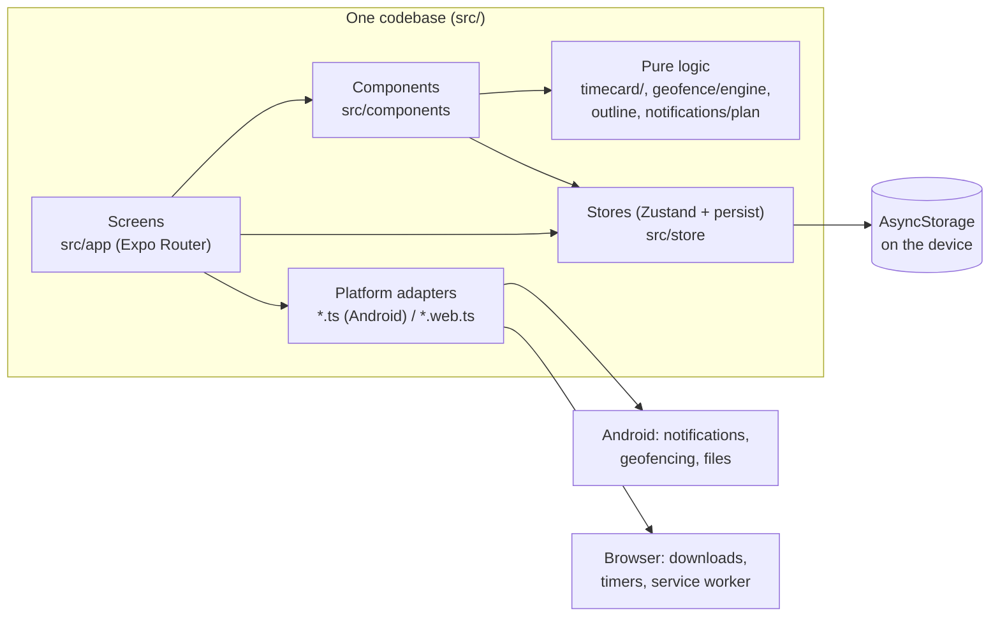
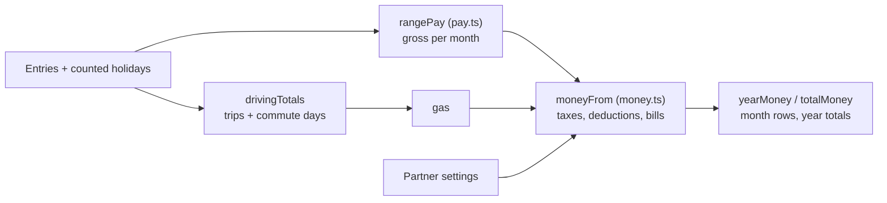
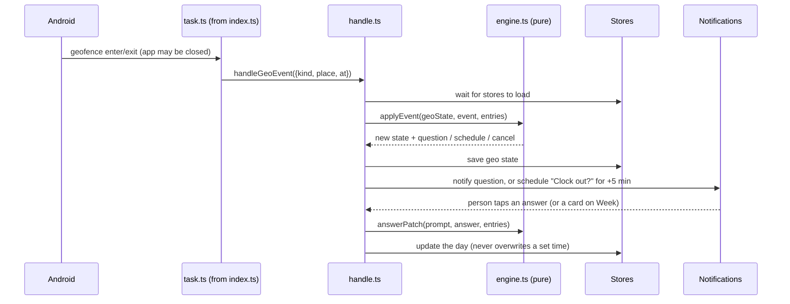

# Punch'd architecture

How the app is put together, for whoever works on it next. Read it with
`CLAUDE.md` (what the app must do) and `docs/PROGRESS.md` (where things
stand). For how to use the app, see `docs/user-guide.md`.

## 1. The shape of it

One TypeScript codebase (Expo SDK 58, React Native, Expo Router) builds
two apps:

- an **Android app**: an APK published as a GitHub pre-release;
- a **web app (PWA)**: GitHub Pages at https://xsosaxdexx.github.io/Time/,
  installable on an iPhone's Home Screen and working offline.

There's **no server**. Everything a person logs is kept on their device
(AsyncStorage: SQLite on Android, `localStorage` on the web) and moved
between devices only by a backup file they save themselves.



## 2. Layers

| Layer             | Where                                                                                           | Rules                                                                                                                                                             |
| ----------------- | ----------------------------------------------------------------------------------------------- | ----------------------------------------------------------------------------------------------------------------------------------------------------------------- |
| Screens           | `src/app/`                                                                                      | Expo Router routes: `(tabs)/index` (Week), `summary`, `charts`, `money`, `settings`; `day/[date]`; `holidays`. Read stores, call logic, lay out components.       |
| Components        | `src/components/`                                                                               | Shared UI: `DayRow`, `WeekTable`, `ColumnChart`, settings sections (`GeoSection`, `FinanceSection`, ...), editors (`BreaksEditor`, `TripsEditor`, `BillsEditor`). |
| Pure logic        | `src/timecard/`, `src/geofence/engine.ts`, `outline.ts`, `text.ts`, `src/notifications/plan.ts` | No React, no device APIs, no clock reads unless passed `now`. This is where the rules live and where most tests are.                                              |
| Stores            | `src/store/`                                                                                    | Zustand stores persisted to AsyncStorage.                                                                                                                         |
| Platform adapters | `*.ts` / `*.web.ts` pairs                                                                       | Metro picks the `.web.ts` file for the web build. Android-only features have web stubs that say they're unavailable.                                              |
| Entry             | `index.ts`                                                                                      | Defines the background geofence task, then starts Expo Router (see §5).                                                                                           |

### Pure logic modules

| File                    | What it owns                                                                                                                                                                                      |
| ----------------------- | ------------------------------------------------------------------------------------------------------------------------------------------------------------------------------------------------- |
| `timecard/calc.ts`      | The spreadsheet formulas: total worked, min clock out, hours so far, week and year stats, odd-day checks, counted holidays (`timeCard`). Must match the owner's Excel exactly (`CLAUDE.md` §3.2). |
| `timecard/dates.ts`     | Date keys (`YYYY-MM-DD`), clock times (`HH:MM`), Monday-based weeks, formatting.                                                                                                                  |
| `timecard/breaks.ts`    | Break times: length, the usual break's slot, add and remove (keeping `breakHours` in step).                                                                                                       |
| `timecard/holidays.ts`  | Holiday rules (fixed date or nth weekday, weekend shifts) and the dates they fall on.                                                                                                             |
| `timecard/pay.ts`       | Estimated pay: weekly overtime, time off paid per type.                                                                                                                                           |
| `timecard/money.ts`     | Taxes, deductions, bills, partner, drives, commute: month by month for the Money tab.                                                                                                             |
| `timecard/charts.ts`    | Chart ranges and bars.                                                                                                                                                                            |
| `timecard/csv.ts`       | CSV export in the HTML page's columns.                                                                                                                                                            |
| `geofence/engine.ts`    | Arrive-and-leave state machine: events in, questions and day changes out.                                                                                                                         |
| `geofence/outline.ts`   | Pasted corners → covering circle (Welzl), point in polygon, distances.                                                                                                                            |
| `notifications/plan.ts` | When the clock-out reminder fires and what it says.                                                                                                                                               |
| `backup/format.ts`      | Backup file build and parse; nothing in a file is trusted.                                                                                                                                        |
| `revision.ts`           | The revision label shown in the app.                                                                                                                                                              |

## 3. Data

### What's stored

| Store         | Storage key        | Contents                                                                                          | In backups |
| ------------- | ------------------ | ------------------------------------------------------------------------------------------------- | ---------- |
| `useEntries`  | `clocked-entries`  | `Record<DateKey, Entry>`: only days with something logged                                         | Yes        |
| `useSettings` | `clocked-settings` | Every setting (`Settings` in `store/settings.ts`)                                                 | Yes        |
| `useGeo`      | `clocked-geo`      | Which places you're in, a pending departure, unanswered questions, what's registered with Android | No         |

The keys still say "clocked" (the app's name until 3 Nov 2026) on purpose:
changing them would lose everyone's data. The same goes for the Android
package `com.clocked.app`, the background task and notification IDs, and
the backup format `clocked-backup`. Only what people see says Punch'd.

### A day (`Entry`, `timecard/types.ts`)

```ts
type Entry = {
  date: DateKey; // "2030-01-07"
  start: ClockTime; // "08:00" or ""
  end: ClockTime;
  breakHours: number; // the total every formula uses
  remoteHours: number;
  timeOffHours: number;
  timeOffType: string;
  travel: '' | 'Yes' | 'No';
  location: string;
  comment: string;
  trips?: Trip[]; // drives: { from, to, miles? }
  breaks?: BreakTime[]; // when breaks were: { start, end }
  skipHoliday?: boolean; // don't count this year's holiday
  holiday?: string; // set on counted holidays; never saved
};
```

- `breakHours` stays the source of truth for calculations, so the formulas
  still match the spreadsheet. `breaks` records _when_; adding or removing
  one through `addBreak`/`removeBreak` changes `breakHours` by its length.
- Company holidays aren't stored: `useTimeCard` adds them for the dates a
  screen asks for (from the first logged day on), unless something is
  logged that day or `skipHoliday` is set.
- A day left with nothing logged is deleted (`isEmptyEntry`).

### Settings changes over time

New settings get their defaults through the persist `merge` (stored
settings spread over the defaults), so adding a field needs no migration.
Optional fields that older saves lack (`taxUnits`, `commuteMiles`, ...)
are typed as optional.

### Backups (`backup/format.ts`)

`{ format: 'clocked-backup', version: 1, exportedAt, settings, entries }`.
Restore also reads the original HTML time card's data and backup files.
Every field has a reader: unreadable days are skipped, bad fields are
blanked, and bad settings fall back to defaults, with counts reported to
the person. **When you add a setting or an entry field, add its reader
and a round-trip test**, or backups will silently drop it.

## 4. Main flows

### Clocking in and out

`ClockButtons` (asks first if a time is already set) →
`useEntries.clockIn/clockOut` → the store persists → `useReminder` sees the plan change
(`notifications/plan.ts`) and reschedules the native notification or web
timer.

### Money tab



Fixed amounts are converted to per month and multiplied by the share of
the month counted (from the first logged day, up to today).

### Arrive and leave (Android)



- **The task is defined in `index.ts`, the app's entry file.** When
  Android wakes a closed app for a geofence it runs the JS bundle without
  showing a screen, so a task defined from a screen or layout is never
  found and the event is dropped. `src/geofence/__tests__/entry.test.ts`
  guards this.
- Only circles can be registered (`expo-location`). An outline becomes the
  smallest covering circle plus 30 m (`outline.ts`).
- `useGeofencing` (mounted by the tabs layout) re-registers the circles on
  the first sync after every app start, because Android drops them on
  reboot, and listens for notification answers.
- The engine is pure and time is passed in, so every scenario (short
  absences, GPS blips at the edge, drives between places, undoing a clock
  out) is a unit test in `geofence/__tests__/engine.test.ts`.

## 5. Build and release

| What            | How                                                                                                                                                                                                                                                                                                                                              |
| --------------- | ------------------------------------------------------------------------------------------------------------------------------------------------------------------------------------------------------------------------------------------------------------------------------------------------------------------------------------------------ |
| Checks          | `npm run check`: TypeScript, ESLint, Prettier, Jest. Run before every commit.                                                                                                                                                                                                                                                                    |
| Android APK     | GitHub Actions **Android preview build** (`android-preview.yml`, run by hand): `expo prebuild`, Gradle release build (arm64), signed with the debug key, published as release `android-preview-N` with `punchd-preview-N.apk`.                                                                                                                   |
| Web app         | GitHub Actions **Web app (GitHub Pages)** (`web-pages.yml`, run by hand): `npm run build:web` with `EXPO_BASE_URL=/Time`. `scripts/postexport-web.mjs` stamps the service worker's precache list and writes `404.html` for deep links.                                                                                                           |
| Revision number | Both workflows check out full history and set `EXPO_PUBLIC_REVISION` (`git rev-list --count HEAD`), `EXPO_PUBLIC_COMMIT`, `EXPO_PUBLIC_BUILT` and, on Android, `EXPO_PUBLIC_BUILD`. Expo inlines them at build time (`src/revision.ts`); other builds show "Revision dev". Tests must not assume "dev", since CI sets the number before testing. |
| Icons           | `npm run icons` regenerates every size from `assets/brand/logo-source.jpg`.                                                                                                                                                                                                                                                                      |

Releasing: commit to `main`, push, then run both workflows (`gh api -X POST
repos/xSOSAxDEXx/Time/actions/workflows/<file>/dispatches -f ref=main`).
Running the Android workflow again cancels one already in progress.

## 6. Decisions and trade-offs

| Decision                                             | Why                                                    | Cost                                                                                  |
| ---------------------------------------------------- | ------------------------------------------------------ | ------------------------------------------------------------------------------------- |
| Local-first, no account or server                    | The owner's rule: no personal data collected           | No sync; moving devices means a backup file                                           |
| Formulas copied exactly from the owner's spreadsheet | Numbers must match what they already trust             | Odd cases (weekends not counting as days worked) stay as they are                     |
| Pure functions for every rule                        | Testable without devices; most bugs caught in Jest     | Screens pass `now` and settings around                                                |
| Circles, no map in the app                           | A Google map needs a Google Cloud account with billing | Outlines are pasted from Google Maps; a covering circle is a bit bigger than the site |
| Ask, never log on its own                            | Location is unreliable; the person stays in control    | One tap per question                                                                  |
| Internal IDs kept as "clocked" after the rename      | Updates install in place with data kept                | The old name shows up in code and storage keys                                        |
| `breakHours` stays the total; break times are extra  | Keeps the spreadsheet formulas and CSV unchanged       | The total and the listed times can differ if the total is typed by hand               |
| Commute counts on days with a start time             | Remote days, time off and holidays don't need gas      | A day logged without a start time won't count its commute                             |

## 7. Where to change things

| To change...                        | Look in                                                                                                             |
| ----------------------------------- | ------------------------------------------------------------------------------------------------------------------- |
| A formula or stat                   | `timecard/calc.ts` and its tests                                                                                    |
| Pay or overtime                     | `timecard/pay.ts`                                                                                                   |
| Money, bills, partner, gas          | `timecard/money.ts`, `app/(tabs)/money.tsx`                                                                         |
| What arrive and leave asks, or when | `geofence/engine.ts`, wording in `geofence/text.ts`                                                                 |
| Share/import places                 | `backup/places.ts` (file, merge), `components/PlacesShare.tsx`                                                      |
| A new setting                       | `store/settings.ts` (type + default), a settings section, `backup/format.ts` reader, a round-trip test              |
| A new day field                     | `timecard/types.ts` (+ `isEmptyEntry`), the day editor, `backup/format.ts` reader, CSV only if the HTML page had it |
| Web-only behaviour                  | the `*.web.ts(x)` twin of the file                                                                                  |

## 8. Tests

Jest with `jest-expo` and React Native Testing Library; `jest.setup.ts`
mocks the native modules (notifications, location, task manager, file
system, date picker). Pure logic is tested directly; screens are tested by
rendering routes with `expo-router/testing-library` and pressing what a
person would. All test data is made up (`CLAUDE.md` §7): no real names,
places or coordinates.
